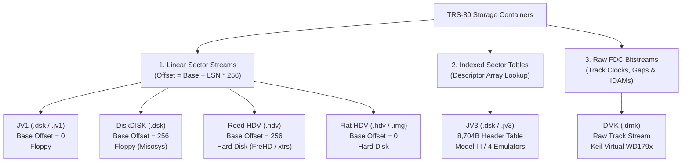

# TRS-80 Model 4 Disk & Hard Drive Image Formats Analysis
## Technical Notes & Proposed Plan Additions for FujiNet Integration

> [!NOTE]
> These research notes document historical and emulator TRS-80 Model 4 disk and hard drive image formats, detailing their binary structures, addressing mechanisms, and compatibility with the FujiNet DriveWire protocol. This document serves as the basis for future updates to [FUJINET-TRS80-INTEGRATION-PLAN.md](file:///Users/richardlucente/development/git/fujinet-trs80-agon/FUJINET-TRS80-INTEGRATION-PLAN.md).

---

## 1. Executive Summary & Format Classification

Storage containers across the TRS-80 Model I, III, and 4 ecosystems fall into three distinct structural paradigms:



1. **Linear Raw Sector Containers (Tier 1 - Direct Streaming Support):**
   - **JV1**, **DiskDISK**, **Reed HDV**, and **Flat HDV**.
   - These formats maintain contiguous, sequential 256-byte sector payloads.
   - Any logical sector (LSN) can be accessed via simple linear arithmetic:
     $$\text{Byte Offset} = \text{Header Offset} + (\text{LSN} \times 256)$$
   - Compatible with FujiNet's DriveWire block protocol without requiring complex server-side sector lookup tables.

2. **Indexed / Non-Linear Sector Containers (Tier 2 - Translation Required):**
   - **JV3**.
   - Contains an 8,704-byte (`0x2200`) header with an indexed table of up to 2,901 sector descriptors.
   - Sectors in the data area are stored in the arbitrary order defined by the table, *not* sequentially by track/sector.
   - Cannot be mapped via linear LSN arithmetic. Requires either pre-boot conversion or an upstream FujiNet server-side media handler (`mediaTypeJV3.cpp`).

3. **Raw FDC Bitstream Containers (Tier 3 - Unsupported for DriveWire LSN):**
   - **DMK**.
   - Emulates raw Western Digital WD177x/WD179x Floppy Disk Controller bitstreams (including clock bits, address marks, gap bytes, and CRC words).
   - Designed for low-level virtual disk controllers handling copy protection. Unsuitable for direct network LSN block streaming; must be converted to JV1 or DiskDISK using offline tools.

---

## 2. Comprehensive Format Specifications

### 2.1 Floppy Disk Image Formats

| Format | Extension | Header Size | Sector Payload Layout | Max Capacity | Primary Characteristics | Direct DriveWire Compatibility |
| :--- | :--- | :--- | :--- | :--- | :--- | :--- |
| **JV1** | `.dsk`, `.jv1` | **0 bytes** | Sequential 256-byte sectors | ~180 KB – 720 KB | Headerless raw stream; directory cylinder typically Track 17. Single density (10 sec/trk) or double density (18 sec/trk). | **Native (Tier 1)**: Flat byte stream. `dw_offset = 0`. Stock `mediaTypeDSK.cpp` compatible. |
| **DiskDISK** | `.dsk` | **256 bytes** | Sequential 256-byte sectors | ~180 KB – 1.44 MB | Created by Roy Soltoff (Misosys). Magic string `'DiskDISK'` at byte 0; bytes `F9h`–`FFh` contain the authentic 7-byte DCT parameter block. | **Native (Tier 1)**: Linear stream with +256B offset. Handled via client `dw_offset = 1`. |
| **JV3** | `.dsk`, `.jv3` | **8,704 bytes** (`0x2200`) | Indexed table + data blocks | ~180 KB – 1.44 MB | Jeff Vavasour format for Model III/4. Supports mixed density (SD Track 0, DD Tracks 1–39/79), two sides, non-standard sector numbers. | **Requires Translation (Tier 2)**: Non-linear. Requires server translator (`mediaTypeJV3.cpp`) or pre-boot converter. |
| **DMK** | `.dmk` | **16 bytes** + 128B IDAM / track | Raw track bitstream | Any floppy size | David Keil raw controller format. Supports copy protection, deleted address marks, arbitrary gaps. | **Unsupported for LSN (Tier 3)**: Requires full virtual FDC hardware emulation. |
| **CPT** | `.cpt` | Variable | Compressed archive | N/A | Matthew Reed Cassette/Disk Portability Tool archive. Not a mountable block device. | **Offline Only**: Must be extracted prior to mounting. |

#### Detailed Anatomy of JV3:
* **Header Structure (8,704 Bytes / `0x2200`):**
  - **Descriptor Array (`0x0000`–`0x21FE`):** Array of 2,901 3-byte entries. Each entry describes one sector payload in the data section:
    - `Byte 0`: Physical Track Number (`0xFF` = free/unused descriptor).
    - `Byte 1`: Physical Sector Number.
    - `Byte 2`: Flags byte:
      - `Bit 7`: Density (`0` = FM / Single Density, `1` = MFM / Double Density).
      - `Bit 4`: Head / Side (`0` = Side 0, `1` = Side 1).
      - `Bits 5–6`: Data Address Mark (`00` = FBh/Normal, `01` = F8h/Deleted DAM).
      - `Bits 0–1`: Sector Size (`0` = 256 bytes, `1` = 128 bytes, `2` = 512 bytes, `3` = 1024 bytes).
  - **Write Protect Byte (`0x21FF`):** `0x00` = Read/Write, `0xFF` = Write Protected.
* **Data Payload (`0x2200` to End of File):**
  - Contains contiguous sector data blocks corresponding 1:1 to the non-`0xFF` entries in the descriptor array.
  - *Lookup Requirement:* To read Track $T$, Sector $S$, the reader must scan the 2,901-entry table for an entry matching $(T, S, \text{side})$. If found at descriptor index $i$, the sector's file offset is $8704 + (i \times 256)$.

#### Detailed Anatomy of DMK:
* **Header Structure (16 Bytes):**
  - `Byte 0`: Write Protect (`0x00` = R/W, `0xFF` = Write Protected).
  - `Byte 1`: Number of tracks (e.g., 40 or 80).
  - `Bytes 2–3`: Track length in bytes (little-endian, e.g., `0x1900` = 6,400 bytes).
  - `Byte 4`: Options flags (`Bit 4` = Single Density only, `Bit 6` = Single Sided).
  - `Bytes 5–11`: Reserved (zeros).
  - `Bytes 12–15`: Real disk flag (`0x12345678`).
* **Track Structure:**
  - Each track begins with a 64-entry IDAM (ID Address Mark) table (128 bytes, two bytes per pointer).
  - Followed by raw track bytes (MFM/FM clock/data stream).

---

### 2.2 Hard Drive Image Formats

| Format | Extension | Header Size | Sector Payload Layout | Max Volume Size | Geometry Specification | Hardware & Emulator Compatibility |
| :--- | :--- | :--- | :--- | :--- | :--- | :--- |
| **Reed HDV** | `.hdv` | **256 bytes** | Sequential 256-byte sectors | 32 MB+ (up to 4 GB over DW) | 256-byte header with signature `56 CB`h, cylinders, heads, and sectors/track. | **Universal Industry Standard**: Matthew Reed TRS32, Tim Mann xtrs, MAME, and physical **FreHD** hard disk interface. |
| **Flat / Raw HDV** | `.hdv`, `.img` | **0 bytes** | Sequential 256-byte sectors | 4 GB | Derived from file size or drive geometry definition. | xtrs flat mode, generic hard disk images. |

#### Detailed Anatomy of Matthew Reed's HDV:
The Reed HDV format is the universal standard for TRS-80 hard disk storage, utilized by all major emulators and modern hardware storage interfaces like **FreHD**:

* **Header Block (Sector 0, 256 Bytes):**
  - **Bytes 0–1:** Magic Identifier: `0x56, 0xCB` (16-bit word `0xCB56`, ASCII `'V'` followed by `0xCB`).
  - **Bytes 2–3:** Number of Cylinders (16-bit little-endian integer, e.g., 203, 306, 615, 1,024).
  - **Byte 4:** Sectors per Track (typically 32 or 34 for Tandy WD1010 controllers).
  - **Byte 5:** Number of Heads / Surfaces (e.g., 2, 4, 6, 8).
  - **Byte 6:** Write Protect Flag (`0x00` = Read/Write, `0x01` = Write Protected).
  - **Bytes 7–255:** Reserved / zeros.
* **Payload Structure:**
  - Standard 256-byte sectors begin immediately at byte offset 256:
    $$\text{Byte Offset} = 256 + (\text{LSN} \times 256)$$
  - This structure matches the **DiskDISK** offset model, allowing identical handling via `dw_offset = 1`.

---

## 3. LS-DOS 6.3.1 Hard Disk Architecture & Partitioning

### 3.1 The 8-Bit Floppy DCT Limit vs. DriveWire 24-Bit LSNs
1. **LS-DOS Floppy Device Control Table (DCT) Constraints:**
   - In standard LS-DOS floppy DCTs (`DCT+6`), the cylinder count is an 8-bit field (maximum 256 cylinders).
   - Single-volume capacity is limited to:
     $$256 \text{ cylinders} \times 1 \text{ head} \times 32 \text{ sectors} \times 256 \text{ bytes} \approx 2.097 \text{ MB}$$
     (Or ~4 MB with 2 heads).
2. **Authentic Hard Disk Partitioning (`RSHARD6/SYS` & `XTRSHARD/DCT`):**
   - Historical Tandy external hard disks (WD1000/WD1010 at I/O ports `0xC0`–`0xC7`) split a physical 5 MB to 20 MB disk into multiple **logical partitions**.
   - Each partition appears to LS-DOS as an independent logical drive (`:0` through `:7`).
   - Sector 0 of the drive (or partition table track) contains partition definitions detailing starting cylinders and lengths.
3. **DriveWire 24-Bit Addressing Advantage:**
   - DriveWire's `OP_READEX` (`0xD2`) and `OP_WRITE` (`0x57`) use 3-byte LSN fields (`LSN_23..16`, `LSN_15..8`, `LSN_7..0`).
   - This directly addresses up to $2^{24} \text{ sectors} = \mathbf{4\text{ Gigabytes}}$.
   - Over DriveWire, large hard disk containers can be supported through two operational models:
     - **Model A (Multi-Slot Image Mapping):** FujiNet mounts individual partition images (or floppy images) into discrete DriveWire slots (0–7).
     - **Model B (Single Large Container Partitioning):** A single 20 MB `.hdv` image is mounted into a DriveWire slot, and a dedicated TRSDOS partition driver (`driver-HDDVR.S`) translates LS-DOS partition drive letters (`:4`–`:7`) to LSN base offsets within that single container.

---

## 4. Proposed Plan Additions: Section by Section

### 4.1 Proposed Additions to Section 3.3 (Boot Lifecycle & Hardware Handover)

Update [Section 3.3](file:///Users/richardlucente/development/git/fujinet-trs80-agon/FUJINET-TRS80-INTEGRATION-PLAN.md#L402-L433) to document pre-boot container classification and hard drive boot branching:

1. **In Step 1 (`FNBOOT` Pre-Boot Inspection):**
   - Add image format validation prior to launching `TRSDOS.bin`:
     - Inspect Slot 0 header:
       - If bytes 0–1 are `0x56 0xCB` (Reed HDV), verify hard disk boot configuration.
       - If container matches JV3 or DMK signatures, display a pre-boot warning:
         `"Container uses non-linear/bitstream format (JV3/DMK). Please convert to JV1 or DiskDISK."`
2. **In Step 4 (`ipl-BIOS.s` Dynamic Network Mount):**
   - Detail the automated 4-tier probe executed by the BIOS during Drive `:0` initialization:
     - Issues `OP_READEX` for wire LSN 0.
     - Tests for `56 CB`h (Reed HDV) $\rightarrow$ sets `dw_offset[0] = 1`, configures hard disk geometry.
     - Tests for `'DiskDISK'` $\rightarrow$ sets `dw_offset[0] = 1`, copies 7-byte DCT block from `F9h`–`FFh`.
     - Tests for GAT on Track 17 $\rightarrow$ sets `dw_offset[0] = 0` (flat JV1).
     - Unrecognized or corrupted header $\rightarrow$ emits diagnostic code to VDP terminal and halts gracefully.

---

### 4.2 Proposed Updates to Section 4 ("Universal Disk Image Support")

#### A. Expand Section 4.1 (Master Format & Geometry Matrix):
Replace the 3-row table with the comprehensive 6-format matrix covering:
- **JV1** (`.dsk`, `.jv1`)
- **DiskDISK** (`.dsk`)
- **Reed HDV** (`.hdv`)
- **Flat HDV** (`.hdv`, `.img`)
- **JV3** (`.dsk`, `.jv3`)
- **DMK** (`.dmk`)

#### B. Update Section 4.2 (4-Tier Container Auto-Detection):
Document the concrete auto-detection logic:

```c
// Pseudocode: 4-Tier Container Classification at Mount Time
uint8_t probe_container_format(uint8_t slot) {
    uint8_t sector_buf[256];
    
    // Read raw wire sector 0
    if (dw_read_sector(slot, 0, sector_buf) != DW_STATUS_OK) {
        return FORMAT_ERROR;
    }
    
    // Tier 1: Check for Reed HDV (Magic: 0x56, 0xCB)
    if (sector_buf[0] == 0x56 && sector_buf[1] == 0xCB) {
        dw_offset[slot] = 1;
        dw_cylinders[slot] = sector_buf[2] | (sector_buf[3] << 8);
        dw_spt[slot]       = sector_buf[4];
        dw_heads[slot]     = sector_buf[5];
        return FORMAT_REED_HDV;
    }
    
    // Tier 2: Check for Misosys DiskDISK (ASCII "DiskDISK")
    if (memcmp(sector_buf, "DiskDISK", 8) == 0) {
        dw_offset[slot] = 1;
        // Bytes 0xF9-0xFF contain 7-byte authentic DCT parameters
        memcpy(&dw_dct_params[slot], &sector_buf[0xF9], 7);
        return FORMAT_DISKDISK;
    }
    
    // Tier 3: Check for JV3 Descriptor Array Signature
    // In JV3, byte 0x21FF is the write-protect byte (0x00 or 0xFF)
    // and unused descriptors have track 0xFF.
    if (is_jv3_container(slot)) {
        return FORMAT_JV3_UNSUPPORTED; // Requires server-side translation or offline conversion
    }
    
    // Tier 4: Fallback to Flat Linear Stream (JV1 or Raw HDV)
    dw_offset[slot] = 0;
    return FORMAT_JV1_FLAT;
}
```

#### C. Expand Section 4.4 (HDV Hard Disk Support vs. Floppy Driver Addressing Bounds):
- Contrast the floppy driver limit (16,384 sectors = 4 MiB) with the hard disk driver capacity (16,777,216 sectors = 4 GiB).
- Document **FreHD compatibility**: because FreHD SD card images use Matthew Reed's `.hdv` format, users can interchange hard drive images between real TRS-80 hardware and Agon FujiNet setups without modification.

#### D. Add Section 4.5: Non-Linear Container Handling Strategy (JV3 & DMK):
- **JV3 Solution Path:**
  - *Option 1 (Firmware Enhancement):* Implement `mediaTypeJV3.cpp` in `fujinet-firmware` to perform descriptor lookups in ESP32 RAM, presenting a linear LSN interface over DriveWire.
  - *Option 2 (Pre-Boot / Offline Tool):* Implement a Quark MOS conversion utility (`*JV3CONV`) to convert JV3 files into flat JV1/DiskDISK images on the Agon SD card.
- **DMK Recommendation:**
  - DMK's raw FDC track bitstreams are designed for copy-protected floppy disks. Because DriveWire is a high-level sector block protocol, DMK images must be converted to JV1/DiskDISK using desktop utilities (`dmk2jv3`, `trstools`) prior to mounting.

---

### 4.3 Proposed Additions to Section 6 & Section 7

#### Section 6 (Storage Architecture):
* **Add Section 6.3.1: Hard Disk Subsystem & Partition Driver (`driver-HDDVR.S`):**
  - Allocate logical drives `:4` through `:7` for hard disk partitions.
  - Detail partition translation:
    $$\text{Target Wire LSN} = \text{Partition Base LSN} + \text{Volume Relative LSN} + \text{dw\_offset}[\text{slot}]$$
  - Maintain compatibility with authentic LS-DOS utilities like `HDSDIR` and `FMT`.

#### Section 7 (Native TRSDOS & Quark MOS Utilities):
* **Add MOS Utilities to Section 7.2:**
  - `*JV3CONV`: Converts JV3 images to flat JV1/DiskDISK format directly under MOS.
  - `*HDVCREATE`: Formats a blank Reed HDV image with a valid `56 CB` header and specified geometry (5 MB, 10 MB, 15 MB, 20 MB).
* **Add In-Guest TRSDOS Commands to Section 7.4:**
  - `HDVMOUNT`: Mounts and configures hard disk partitions for drives `:4`–`:7`.
  - `DSKINFO`: Diagnostic tool displaying mounted container format (JV1, DiskDISK, Reed HDV), header offset (`dw_offset`), geometry, and write protection status.

---

## 5. Architectural Decisions for Future Review

When revisiting this document for implementation, consider the following design decisions:

1. **Hard Disk Partitioning Model:**
   - **Option A (Discrete Slot Mounts):** FujiNet mounts individual partition images into discrete DriveWire slots. Simple to implement; no partition driver needed.
   - **Option B (Master HDV Container with `driver-HDDVR.S`):** Mounts a single 20 MB `.hdv` file, and an LS-DOS driver handles partitioning across drives `:4`–`:7`. Provides 100% parity with authentic physical hard drives and FreHD images.

2. **JV3 Handling Location:**
   - **Option A (Agon / MOS Layer):** Keep FujiNet firmware unpatched; convert JV3 files to JV1/DiskDISK using a MOS utility (`*JV3CONV`).
   - **Option B (FujiNet Firmware Layer):** Add `mediaTypeJV3.cpp` to the ESP32 server firmware, enabling transparent network mounting of `.jv3` files without user pre-conversion.
