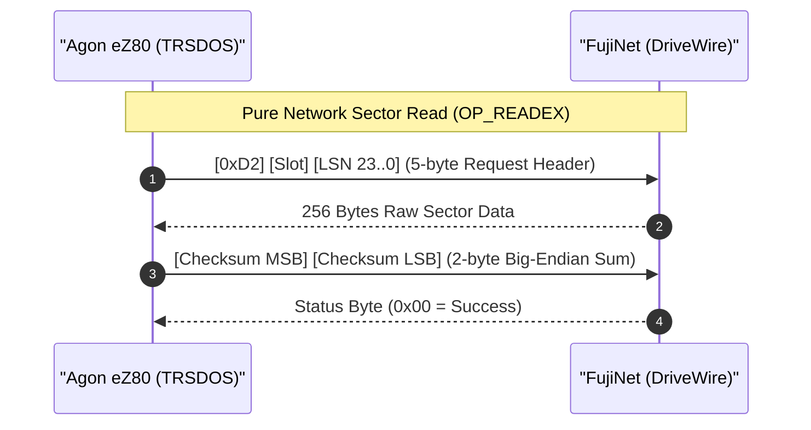

# Phase 1 Implementation Explanation: Pure DriveWire Network Boot and VDP Glitch Elimination

This document provides a comprehensive, technical explanation of all architectural concepts, design rationales, and assembly code modifications implemented for **Phase 1: Lean Kernel & Network Boot Proof** of the FujiNet TRS-80 integration for the Olimex Agon Light 2.

---

## 1. Executive Summary & Phase 1 Objectives

Phase 1 establishes the baseline for running the TRS-80 Model 4 operating system (TRSDOS 6.3.1 / LS-DOS 6.3 adapted for the Zilog eZ80) as a network-first client. 

### Core Deliverables Achieved in Phase 1:
1. **Lean System Image (~64 KB):** Completely severed the legacy 425 KB embedded RAM disk from `TRSDOS.bin`, shrinking the kernel binary from ~480 KB down to **66,048 bytes** (`0x000000`–`0x0101FF`) and freeing **448 KB of external SRAM** (`0x010000`–`0x07FFFF`) for user programs, expanded memory, and sector caches.
2. **Pure Network Boot over DriveWire 3/4:** Implemented direct booting of system Drive `:0` from FujiNet Virtual Device Slot 0 over UART1 using the standard binary DriveWire `OP_READEX` (`0xD2`) protocol with big-endian checksum verification.
3. **Container Format Transparency:** Implemented dynamic container detection supporting both raw sector images (JV1, 0-offset) and authentic Misosys container images (DiskDISK, 1-sector header offset).
4. **Stage 1 Read-Only Protection:** Implemented hard write rejection (`R_PROTECTED` / Error 15) in the driver layer, guaranteeing that host disk images cannot be corrupted while upstream write routines are audited.
5. **Agon VDP & Terminal Glitch Elimination:** Resolved all display artifacts, phantom `'P'` keystrokes, and the persistent blinking green block cursor arising from Agon VDP packet traffic and `fabgl::Terminal` emulation.

---

## 2. Architectural Overview: Embedded Monolith vs. Lean Network Client

### 2.1 The Upstream Baseline Problem
In Daniel Paul Martin's original port of TRSDOS 7 for the Agon Light (`trs-os-zds`), the operating system image `TRSDOS.bin` was monolithic (~480 KB). During assembly, an entire 425 KB formatted TRSDOS floppy disk image was statically embedded into the kernel binary between physical addresses `0x010000` and `0x07FFFF`.

At boot time:
- Initial Program Load (IPL) executed in-memory block transfers (`LDIR.L`) to copy virtual disk "slices" from high memory to low memory buffers.
- The floppy disk controller driver (`driver-FDCDVR.S`) intercepted Drive `:0` sector reads and redirected them into 24-bit memory transfers from the embedded image in SRAM.
- **Consequences:** 
  - Every boot re-read the static in-memory image; any files created or modified during a session were volatile and lost on reboot.
  - The Agon Light 2's 512 KB SRAM was almost entirely consumed by this static disk image, leaving zero headroom for expanded memory models (Tandy 128K Bank 1 or Dave Huffman / Anitek SuperMEM 512K).
  - Booting over the network was impossible because Drive `:0` was hardwired to the internal RAM disk slices.

### 2.2 The Phase 1 Solution
Phase 1 eliminates the static embedded disk image from the kernel build. `TRSDOS.bin` now terminates at address `0x0101FF` (containing solely the kernel, HAL, drivers, and IPL initialization routines).

```text
+-------------------------------------------------------------------------------+
|                     AGON LIGHT 2 MEMORY MAP (512 KB SRAM)                     |
|                                                                               |
| 0x000000 +------------------------------------------------------------------+ |
|          | TRSDOS 7 Kernel, HAL, Drivers, System Buffers (~64 KB)           | |
| 0x010000 +------------------------------------------------------------------+ |
|          |                                                                  | |
|          | FREED EXTERNAL SRAM (~448 KB)                                    | |
|          | - Emulated Model 4 Bank 1 (32 KB: 0x010000-0x017FFF)             | |
|          | - Anitek SuperMEM Banks 2-7 (192 KB: 0x018000-0x07FFFF)          | |
|          | - High-Speed Sector Caches & Dynamic RAM Disks                   | |
|          |                                                                  | |
| 0x07FFFF +------------------------------------------------------------------+ |
+-------------------------------------------------------------------------------+
```

When the eZ80 starts:
1. `TRSDOS.bin` initializes processor registers and HAL tables.
2. IPL issues DriveWire sector read commands over UART1 to request Sector 0, the Granule Allocation Table (GAT), and system files (`SYS0.SYS` through `SYS6.SYS`) directly from FujiNet Virtual Device Slot 0.
3. Every file write or directory modification commits directly over the network to the disk image hosted by FujiNet, achieving 100% data persistence.

---

## 3. DriveWire 3/4 Protocol Mechanics on eZ80 UART1

### 3.1 Packet Frame Structure for `OP_READEX` (`0xD2`)
The DriveWire 3/4 protocol uses binary command frames. For disk sector reads, Phase 1 implements opcode `0xD2` (`OP_READEX`), which supports 24-bit Logical Sector Numbers (LSN) and 16-bit big-endian checksums.



```text
CLIENT (Agon eZ80)                                    SERVER (FujiNet / DriveWire)
       |                                                         |
       | ----- [ 0xD2 ] [ Slot ] [ LSN23..0 (3B) ] ------------> |  (5-byte Request Header)
       |                                                         |
       | <---- [ 256 Bytes Sector Data ] ----------------------- |  (Raw Sector Payload)
       |                                                         |
       | ----- [ Checksum MSB ] [ Checksum LSB ] --------------> |  (2-byte Client Checksum)
       |                                                         |
       | <---- [ Status Byte (0x00 = OK) ] ---------------------- |  (1-byte Operation Status)
       |                                                         |
```

1. **Request Header (5 bytes):**
   - Byte 0: Opcode `0xD2` (`OP_READEX`).
   - Byte 1: Virtual Device Slot (`0x00` for Drive `:0`, up to `0x03` in Stage 1).
   - Bytes 2–4: Logical Sector Number in big-endian format (`LSN[23..16]`, `LSN[15..8]`, `LSN[7..0]`).
2. **Data Transfer:**
   - Server streams 256 consecutive raw data bytes over UART1.
   - Client receives the bytes directly into the caller's target buffer in memory.
3. **Checksum Verification:**
   - Client calculates an unsigned 16-bit arithmetic summation of all 256 bytes: `sum = sum(b_i) mod 65536`.
   - Client transmits this 16-bit sum as 2 bytes in **big-endian order** (`MSB`, then `LSB`).
   - Server compares the client's checksum against its own computed checksum.
4. **Status Acknowledgment:**
   - Server returns 1 byte: `0x00` indicates success; non-zero indicates a checksum mismatch or drive fault.

### 3.2 Big-Endian Checksum Algorithm
Because DriveWire originated on the Motorola 6809 architecture, multi-byte integers and checksums on the wire are strictly big-endian (most significant byte first). The Zilog eZ80 is natively little-endian.

The checksum routine (`calc_dw_checksum`) implements this directly in registers:
- 16-bit accumulator in register pair `DE` (`D` = MSB, `E` = LSB), initialized to `0x0000`.
- Register `B` initialized to `0` (controlling a 256-iteration loop via `DJNZ`).
- For each byte: add to `E`. If the addition overflows (carry flag set), increment `D`.

### 3.3 Container Header Offsetting (`dw_offset`)
The TRS-80 ecosystem uses two primary disk container formats:
1. **Raw Images (JV1):** Unformatted flat sector dumps where physical Sector 0 of the file is filesystem Sector 0 (LSN 0).
2. **Misosys DiskDISK Images:** Authentic images containing a 256-byte metadata header at the very beginning of the file. This header contains the original Disk Control Table (DCT) parameters, volume label, and format flags. Consequently, the actual filesystem Sector 0 (GAT) begins at file offset +256 bytes (physical LSN 1).

To handle both transparently, Phase 1 implements a dynamic container inspection routine:
- At boot, IPL reads physical LSN 0 into a temporary buffer.
- It inspects the first 8 bytes for the ASCII string `'DiskDISK'`.
- If matched: `dw_offset = 1`. All subsequent sector addresses calculated by TRSDOS are adjusted: `Wire LSN = TRSDOS LSN + 1`.
- If not matched: `dw_offset = 0`. All sector addresses map 1:1.

### 3.4 Stage 1 Safety: Read-Only Write Protection
To prevent accidental corruption of user disk images on the FujiNet host while upstream server write routines are being audited, Phase 1 strictly enforces read-only access:
- During boot, bit 7 of byte 3 in the Disk Control Table for Drive 0 (`DCT0$+3`) is set (`SET 7, (IY+3)`).
- The write dispatch routine in the driver (`DOWRIT`) immediately rejects write requests with `R_PROTECTED` (Error code 15) and sets the non-zero flag (`NZ`), returning control cleanly to the operating system without asserting any wire traffic.

---

## 4. Code Walkthrough: Patch 1 (`patches/0001-uart1-streaming.patch`)

The eZ80F92 on the Agon Light 2 communicates with the Olimex MOD-WIFI-ESP8266 or direct serial interfaces via UART1 on the 10-pin UEXT connector (`PC0`/`PC1`).

### 4.1 Hardware Register Configuration
`patches/0001-uart1-streaming.patch` configures the on-chip UART1 peripheral for polled streaming:

```z80
; Configure UART1 for streaming DriveWire I/O
ld      a, 07h
out0    (UART1_FCTL), a         ; Reset & enable RX/TX FIFOs (FIFO trigger level 1)

ld      a, 03h
out0    (UART1_LCR), a          ; Line Control: 8 data bits, 1 stop bit, no parity (8-N-1)

xor     a
out0    (UART1_IER), a          ; Disable UART1 hardware interrupts (polled operation)

ld      a, 03h
out0    (UART1_MCR), a          ; Modem Control: Assert DTR and RTS high
```

### 4.2 Rationale
1. **FIFO Control (`UART1_FCTL = 0x07`):** Writing `0x07` sets bit 0 (FIFO Enable), bit 1 (RX FIFO Clear), and bit 2 (TX FIFO Clear). Draining the hardware queues ensures no residual bytes from prior MOS operations pollute the DriveWire packet stream.
2. **Polled Mode (`UART1_IER = 0x00`):** DriveWire sector transfers occur in synchronized request-response blocks. Operating in polled mode avoids interrupt overhead, eliminates re-entrancy conflicts with TRSDOS timer interrupts, and maximizes wire throughput.

---

## 5. Code Walkthrough: Patch 2 (`patches/0002-fujinet-drivewire-boot.patch`)

Patch 2 replaces the static RAM disk boot mechanism with the DriveWire network boot engine.

### 5.1 Global Symbol Exports (`TRSDOS_GLOBAL/equates/equates-global-lowcore.s`)
The following symbols were added to the kernel global symbol table so they can be referenced across both IPL (`ipl-BIOS.s`) and the runtime driver (`driver-FDCDVR.S`):

```z80
XDEF    dw_offset               ; 8-byte table: per-drive container header offset (0 or 1)
XDEF    dw_hdr                  ; 5-byte buffer: OP_READEX request packet header
XDEF    dw_chk                  ; 2-byte buffer: big-endian checksum
XDEF    dw_status               ; 1-byte buffer: server return status
XDEF    dw_slot                 ; 1-byte variable: active virtual slot ID
XDEF    calc_dw_checksum        ; Routine: 16-bit big-endian checksum calculation
```

---

### 5.2 Network Initial Program Load (`TRSDOS_7/SYS0_IPL/ipl-BIOS.s`)

Upstream `ipl-BIOS.s` contained over 400 lines of Z80 assembly dedicated to reading slice tables from physical SRAM address `0x010000`, calculating pointer offsets, and using `LDIR.L` to copy sectors into memory.

Patch 2 removes all slice-copy routines and replaces them with a clean DriveWire network boot sequence:

#### Step 1: Flushing FIFOs and Requesting Physical LSN 0
```z80
; Read FujiNet Slot 0 LSN 0 (raw sector 0 / container header) over UART1
ld      a, 07h                          ; Flush UART1 RX and TX FIFOs
out0    (UART1_FCTL), a

ld      hl, dw_hdr
ld      (hl), 0D2h                      ; Opcode 0xD2 = OP_READEX
inc     hl
ld      (hl), 0                         ; Slot 0 (Drive :0)
inc     hl
ld      (hl), 0                         ; LSN [23..16] = 0
inc     hl
ld      (hl), 0                         ; LSN [15..8]  = 0
inc     hl
ld      (hl), 0                         ; LSN [7..0]   = 0

UART1.put.bytes 5, dw_hdr, mounterr0    ; Send 5-byte header, jump to error on timeout
UART1.get.bytes 0, volbuf, mounterr0    ; Receive 256 bytes (len=0) into volbuf
```
- `UART1.put.bytes` streams the 5-byte packet out of `UART1_THR`, checking `UART1_LSR` (THRE bit) on each byte.
- `UART1.get.bytes 0, volbuf` receives exactly 256 bytes directly into `volbuf` (length parameter `0` represents a 256-byte page).

#### Step 2: Checksum Verification & Status Check
```z80
ld      hl, volbuf
call    calc_dw_checksum                ; Computes sum: D=MSB, E=LSB
ld      a, d
ld      (dw_chk+0), a                   ; Store MSB first (big-endian)
ld      a, e
ld      (dw_chk+1), a                   ; Store LSB second

UART1.put.bytes 2, dw_chk, mounterr0    ; Transmit 2-byte checksum to FujiNet
UART1.get.bytes 1, dw_status, mounterr0 ; Fetch 1-byte status

ld      a, (dw_status)
or      a
jp      nz, mounterr0                   ; Non-zero indicates checksum error or drive fault
```

#### Step 3: Container Detection and DCT0 Configuration
```z80
; Test if first 8 bytes match ASCII 'DiskDISK'
ld      bc, 8
ld      hl, string1$                    ; Points to string 'DiskDISK'
ld      de, volbuf
tstmore0:
ld      a, (de)
inc     de
cpi                                     ; Compare (HL) with (DE), inc HL, dec BC
jp      nz, not_diskdisk0               ; Mismatch -> JV1 format
jp      v, tstmore0                     ; BC not zero -> continue loop

; --- Path A: DiskDISK Container Detected ---
ld      a, 1
ld      (dw_offset), a                  ; Wire LSN offset = +1 sector
mov.BYT volbuf, boottyp$, 8             ; Copy format label to menu display
MVC     volbuf+11, DCT0$+3, 7           ; Copy authentic DCT parameters from container header
ld      iy, DCT0$
set     7, (iy+3)                       ; Enable Stage 1 Read-Only write protection
set     0, (iy+4)                       ; Designate as Drive 0
set     4, (iy+4)                       ; Flag as alien/non-standard controller
jr      past_jv1_0

; --- Path B: Raw JV1 Container Detected ---
not_diskdisk0:
xor     a
ld      (dw_offset), a                  ; Wire LSN offset = 0
MVC     jv1$, boottyp$, 8               ; Copy 'JV1' to boot menu
ld      a, (volbuf+2)                   ; Read directory cylinder pointer from Sector 0
ld      (DCT0$+9), a                    ; Store in DCT0 directory cylinder register
ld      iy, DCT0$
set     7, (iy+3)                       ; Enable Stage 1 Read-Only write protection
set     0, (iy+4)
set     4, (iy+4)

past_jv1_0:
```
- In DiskDISK mode, bytes 11–17 of the header contain the authentic disk geometry (cylinders, sectors per track, number of heads). The macro `MVC` (Move Characters) transfers this metadata directly into `DCT0$`.
- In JV1 mode, the directory track location is read directly from byte offset 2 of Sector 0.
- `SET 7, (IY+3)` marks the drive as write-protected in TRSDOS system tables.

#### Step 4: Deactivating Secondary Slices
```z80
; Phase 1: Set Drive 1 inactive (stub with RET opcode 0xC9)
ld      iy, DCT1$
ld      (iy+0), 0C9h                    ; Entry point becomes a direct RET
ld      iy, DCT0$
```
Upstream code attempted to mount a second RAM disk for Drive `:1`. In Phase 1, Drive `:1` is cleanly stubbed out by writing `0xC9` (`RET`) into the first byte of its driver dispatch table, leaving Drive `:0` as the sole active boot volume.

---

### 5.3 Runtime Disk Driver Integration (`TRSDOS_7/SYSRES/drivers/driver-FDCDVR.S`)

When TRSDOS executes file operations (`LOAD`, `DIR`, `RUN`), the kernel invokes the Floppy Disk Controller Driver (`FDCDVR`). Upstream code routed Drive `:0` requests to memory copies and Drive `:6` to a custom serial network protocol.

Patch 2 unifies storage access by routing all disk reads directly through DriveWire:

#### Step 1: LSN Calculation and Header Offsetting
```z80
rd_drivewire:
ld      a, (LDRV$)                      ; Get requested logical drive number (0-7)
ld      (dw_slot), a                    ; Map 1:1 to FujiNet Device Slot

; Fetch container offset for this drive (0 for JV1, 1 for DiskDISK)
ld      e, a
ld      d, 0
ld      hl, dw_offset
add     hl, de
ld      e, (hl)                         ; E = offset (0 or 1)
ld      hl, (fdc_no_sum)                ; HL = calculated Logical Sector Number
add     hl, de                          ; HL = Wire LSN adjusted for container header

; Construct 5-byte OP_READEX request packet
ld      a, 0D2h                         ; Opcode 0xD2 (OP_READEX)
ld      (dw_hdr+0), a
ld      a, (dw_slot)                    ; Device Slot
ld      (dw_hdr+1), a
xor     a
ld      (dw_hdr+2), a                   ; LSN [23..16] = 0
ld      a, h
ld      (dw_hdr+3), a                   ; LSN [15..8]
ld      a, l
ld      (dw_hdr+4), a                   ; LSN [7..0]
```
`calcsec` translates TRSDOS track/cylinder and sector coordinates into an absolute 16-bit Logical Sector Number:
`LSN = (Cylinder * Heads * Sectors/Track) + (Head * Sectors/Track) + Sector`
The driver adds `dw_offset` so that filesystem LSN 0 correctly references file LSN 1 on DiskDISK images.

#### Step 2: FIFO Flush & Wire Exchange
```z80
ld      a, 07h
out0    (UART1_FCTL), a                 ; Flush UART1 FIFOs

UART1.put.bytes 5, dw_hdr, fdc_rd_timeout

pop     hl                              ; Recover caller destination buffer address
push    hl                              ; Save pointer for checksum routine
UART1.get.bytes 0, hl, fdc_rd_timeout   ; Stream 256 bytes directly into buffer

pop     hl                              ; Recover buffer pointer
push    hl                              ; Keep on stack for completion handler
call    calc_dw_checksum                ; Compute 16-bit big-endian checksum
ld      a, d
ld      (dw_chk+0), a                   ; MSB
ld      a, e
ld      (dw_chk+1), a                   ; LSB

UART1.put.bytes 2, dw_chk, fdc_rd_timeout
UART1.get.bytes 1, dw_status, fdc_rd_timeout

ld      a, (dw_status)
or      a
jr      nz, fdc_rd_err                  ; Error if status != 0x00

pop     hl                              ; Balance stack
jp      rd_finish                       ; Transfer to authentic LS-DOS completion handler
```

#### Step 3: Big-Endian Checksum Subroutine (`calc_dw_checksum`)
```z80
calc_dw_checksum:
ld      de, 0                           ; DE = 16-bit big-endian accumulator
ld      b, 0                            ; B = 0 -> 256 iterations via DJNZ
dw_chk_loop:
ld      a, (hl)                         ; Read byte from buffer
inc     hl                              ; Advance pointer
add     a, e                            ; Add to low byte
ld      e, a                            ; Store low byte
jr      nc, dw_chk_nocarry              ; If no carry, skip high byte increment
inc     d                               ; Increment high byte on overflow
dw_chk_nocarry:
djnz    dw_chk_loop                     ; Decrement B, loop until B rolls back to 0
ret
```

#### Step 4: Write Rejection (`DOWRIT`)
```z80
DOWRIT: ; Stage 1 write protection: reject all writes with R_PROTECTED (Error 15)
pop     bc                              ; Restore caller registers
pop     hl
ld      a, 15                           ; Error 15 = R_PROTECTED (Write Protected)
or      a                               ; Set Non-Zero (NZ) flag indicating error
ei                                      ; Re-enable interrupts
ret
```

---

### 5.4 Auto-Booting directly to TRSDOS Prompt (`TRSDOS_7/SYS0_IPL/ipl-DOS.S`)
Upstream TRSDOS presented interactive configuration menus during IPL asking the user whether to run `ICNFG`, execute background multitasking, or run an `AUTO` command.

Patch 2 eliminates manual intervention, allowing the system to boot non-interactively:

```z80
--- a/TRSDOS_7/SYS0_IPL/ipl-DOS.S
+++ b/TRSDOS_7/SYS0_IPL/ipl-DOS.S
@@ -76,9 +76,7 @@
                call query_server               ; Get server parameters.
                call bind_server                ; Bind server & client (me).
 
-ipl_chk_quiet  ld      a,(quiet_default_flg)   ; Get quiet/default IPL code.
-               and     10000000b               ; Isolate quiet flag.
-               IF_NE_GOTO default_ipl  ; Bypass if quiet off.
+ipl_chk_quiet  GOTO    default_ipl             ; Auto-boot directly to default TRSDOS IPL
```
This change bypasses the interactive text queries and jumps unconditionally to `default_ipl`, launching straight into the `LS-DOS Ready` command prompt.

---

## 6. Code Walkthrough: Patch 3 (`patches/0003-fix-vdp-display-and-keyboard-glitches.patch`)

Patch 3 resolves several subtle firmware and emulation conflicts between the Agon VDP architecture and TRSDOS.

### 6.1 The Problems Observed
1. **Phantom Keystrokes & Mode Loops:** Upon boot, TRSDOS frequently displayed characters like `"P_"` or repeated `"LS-DOS Ready"`.
2. **Double Prompt & Screen Offsets:** The prompt rendered twice, or began at row 22 instead of row 0.
3. **The Persistent Blinking Block Cursor:** A solid green rectangular block cursor remained permanently frozen in the lower area of the screen, blinking asynchronously from the native TRSDOS software underscore (`_`) cursor.

### 6.2 Root Cause Discovery: Agon VDP Dual Architecture (`VDU` vs. `fabgl::Terminal`)
By running `fab-agon-emulator --verbose` and inspecting the VDP debug logs, a critical structural reality was uncovered:

```text
ESP32 DBGSerial: vdu_mode: 4
ESP32 DBGSerial: changeMode: canvas(640,240), mode 4
ESP32 DBGSerial: Terminal enabled
```

When `autoexec.txt` invokes `OSboot -2f TRSDOS.bin`:
1. `OSboot` explicitly switches the Agon VDP into **`fabgl::Terminal` mode** (`TerminalState::Enabled` in [`agon-vdp/video/video.ino:274-318`](file:///Users/richardlucente/development/git/agon-vdp/video/video.ino#L274-L318)).
2. `video.ino:279` executes `Terminal->enableCursor(true);`, turning on FabGL's internal text cursor sprite.
3. While `TerminalState` is `Enabled`, all incoming UART0 bytes bypass the BBC VDU command processor and are fed directly to `Terminal->write(b)` as ANSI/VT100 terminal data.
4. **Why BBC VDU Commands Failed:** Commands like `VDU 23, 1, 0` (disable cursor) or `VDU 23, 0, 10, 32` (CRTC cursor off) were treated by the terminal emulator as raw ASCII control codes (`ETB`, `SOH`, `NUL`). Worse, control code `10` was interpreted as Line Feed (`LF`) and code `32` was printed as a space, causing the cursor to jump from column 79 to column 1 and resume blinking.
5. **Why Phantom 'P' Keystrokes Appeared:** When the VDP switches modes, it transmits an asynchronous status packet over UART0: `[0x86] [len] [payload...]` (`PACKET_MODE`). For Mode 4, the payload contained the byte `0x50` (ASCII `'P'`). The TRSDOS keyboard driver (`driver-UART0.S`) did not recognize VDP packets and treated `0x50` as a physical user keystroke.

---

### 6.3 Detailed Code Changes in Patch 3

#### 1. Binary VDP Packet Filter & Keycode Parser (`driver-UART0.S`)
In `driver-UART0.S`, incoming bytes from `UART0_RBR` are inspected before passing to `@KEYIN`:

```z80
CKINP:
        IN0     A, (UART0_LSR)          ; Check if data is available
        AND     UART_DR
        JR      Z, nochar

        IN0     A, (UART0_RBR)          ; Read byte from UART0
        BIT     7, A                    ; Agon VDP packets always have bit 7 set (>= 0x80)
        JR      NZ, vdp_pkt             ; If bit 7 set, route to packet decoder
        LD      C, A                    ; Normal ASCII character
norm_char:
        ...                             ; Normal TRSDOS key processing
```

If bit 7 is set, `vdp_pkt` decodes the packet according to the Agon VDP protocol:
- Byte 0: Packet code (`0x80` + type).
- Byte 1: Payload length.
- Remaining bytes: Packet payload.

```z80
vdp_pkt:
        PUSH    DE
        LD      D, A                    ; D = packet code
        CALL    u0_gb                   ; Read length byte
        LD      E, A                    ; E = payload length
        LD      A, D
        CP      81h                     ; Is it PACKET_KEYCODE (0x81)?
        JR      NZ, vdp_discard         ; If not, discard the packet entirely

        ; Packet 0x81: [ASCII] [Modifiers] [VK_Code] [Is_Down]
        CALL    u0_gb                   ; Byte 1: ASCII code
        LD      D, A                    ; Save ASCII in D
        CALL    u0_gb                   ; Byte 2: Modifiers (Shift/Ctrl/Alt)
        CALL    u0_gb                   ; Byte 3: Virtual key code
        CALL    u0_gb                   ; Byte 4: Key state (1=Pressed, 0=Released)
        OR      A                       ; Test key state
        JR      Z, vdp_next             ; Ignore key releases
        LD      A, D                    ; Recover ASCII character
        OR      A                       ; Valid printable character?
        JR      Z, vdp_next             ; Ignore non-ASCII control/function keys
        POP     DE
        LD      C, A                    ; Place valid character in C
        JP      norm_char               ; Inject directly into normal keystroke flow

vdp_discard:
        LD      A, E                    ; Check remaining payload bytes
        OR      A
        JR      Z, vdp_next
        CALL    u0_gb                   ; Drain unneeded payload byte
        DEC     E
        JR      vdp_discard

vdp_next:
        POP     DE
        JP      CKINP                   ; Re-check FIFO for next character
```
- Discards `PACKET_MODE` (`0x86`), `PACKET_MOUSE` (`0x89`), and all other metadata packets, eliminating phantom keystrokes.
- Filters out key release events (`is_down == 0`), preventing double-character registration.

#### 2. One-Time Startup FIFO Drain (`flush_u0_fifo`)
Packets queued in UART0 by MOS, font loading, or OSboot prior to TRSDOS executing are purged during the first `CKINP` call:

```z80
CKINP:
        LD      A, (u0_flushed_flg)
        OR      A
        JR      NZ, u0_is_clean
        INC     A
        LD      (u0_flushed_flg), A     ; Set flag: flush only once at startup
        CALL    flush_u0_fifo
u0_is_clean:
```

`flush_u0_fifo` reads until `UART0_LSR` reports no data waiting for `0x2000` consecutive iterations, ensuring the FIFO is completely quiet before the prompt appears.

#### 3. Complete Elimination of the Blinking Block Cursor
Because `fabgl::Terminal` interprets ANSI/VT100 escape codes, cursor suppression must use **`ESC [ ? 25 l`** (DEC Text Cursor Enable Mode - Reset):

1. **In `driver-UART0.S` (`hide_vdp_cursor`):**
   Immediately after draining the FIFO on the first `CKINP` call, `hide_vdp_cursor` transmits the cursor suppression sequence using `CALL TXUART0`:
   ```z80
   hide_vdp_cursor:
           PUSH    HL
           PUSH    AF
           PUSH    BC
           LD      HL, vdu_cur_off_seq
   hvc_loop:
           LD      A, (HL)
           INC     HL
           CP      0FFh
           JR      Z, hvc_done
           LD      C, A
           CALL    TXUART0                 ; Transmits with CTS and THRE flow control
           JR      hvc_loop
   hvc_done:
           POP     BC
           POP     AF
           POP     HL
           RET

   vdu_cur_off_seq:
           db      ESC.asc, "[?25l"        ; VT100: Hide cursor in fabgl::Terminal
           db      23, 1, 0                ; Agon VDU: disable text cursor
           db      23, 0, 10, 32           ; Agon VDU: CRTC reg 10 cursor off
           db      23, 0, 11, 0            ; Agon VDU: CRTC reg 11 cursor end=0
           db      0FFh                    ; End of sequence marker
   ```

2. **In `ipl-strings.s` (`vt100_clear$`):**
   ```z80
   vt100_clear$ db ESC.asc, "[?25l", 12, 23, 1, 0, ETX.asc
   vt100_home$  db ESC.asc, "[f", 30, ETX.asc
   ```
   Before TRSDOS displays the splash screen or prompt, `vt100_clear$` sends `ESC [ ? 25 l` and Form Feed (`12`), extinguishing the cursor before the first character is drawn.

3. **In `memory_video.s` and `interrupt_handler.s` (Video Pump Refresh):**
   TRSDOS maintains video RAM at `zspace.VIDEO$`. A periodic timer interrupt in `interrupt_handler.s` pumps video memory to UART0 whenever the screen changes.
   In `memory_video.s`:
   ```z80
   org     zspace.VIDEO$-9
   db      ESC.asc, "[f"                   ; Cursor to home position (3 bytes: 1Bh, 5Bh, 66h)
   db      ESC.asc, "[?25l"                ; Hide cursor in fabgl::Terminal (6 bytes: 1Bh, 5Bh, 3Fh, 32h, 35h, 6Ch)
   ```
   In `interrupt_handler.s`:
   ```z80
   ld      hl, zspace.VIDEO$-9             ; Point to prefix + video RAM
   ld      de, CRTSIZE+9                   ; 1920 bytes video RAM + 9 prefix bytes
   ```
   Every screen refresh begins with `ESC [ f` (home cursor) and `ESC [ ? 25 l` (hide cursor), followed by the 1920 screen characters. This guarantees that:
   - The terminal cursor never reappears after a screen redraw.
   - All 1920 bytes of video memory are transmitted without truncating the bottom lines.
   - The native TRSDOS software underscore cursor `_` (drawn directly into `zspace.VIDEO$` by the OS) remains fully visible and interactive.

#### 4. Session Command & Cursor Origin Fixes
- **`ipl_sessions.s`:** In upstream code, `realtim` initialized `session_cmd$` with `"cls"`, which re-invoked the command interpreter and caused the prompt to render twice. Patch 3 changes this to `MVC defltterm$, session_cmd$, 15`, populating the buffer with spaces so the OS exits cleanly via `SYS_EXIT 0` directly to `LS-DOS Ready`.
- **`ipl-trsdos.s`:** Changed `locate.CURSOR 22,0` to `locate.CURSOR 0,0`, positioning the initial prompt cleanly at the top of the screen.
- **`driver-UART0.S`:** Replaced relative jumps (`JR`) in `CTLUART0` with absolute jumps (`JP`) to avoid branch range overflow errors.

---

## 7. Step-by-Step Execution Trace

### 7.1 Cold Boot Sequence
1. **Power On / Emulator Startup:**
   - Agon MOS initializes the eZ80 hardware and loads `autoexec.txt`.
   - `autoexec.txt` executes `OSboot -2f TRSDOS.bin`.
   - `OSboot` signals the Agon VDP to enter `fabgl::Terminal` mode and loads `TRSDOS.bin` at address `0x000000`.
2. **HAL & Interrupt Initialization:**
   - TRSDOS sets up the vector table at `INTERRUPT.handler`.
   - UART1 is initialized for 8-N-1 polled streaming at baud 0.
3. **IPL Boot Sector Retrieval (`ipl-BIOS.s`):**
   - Transmits `[ 0xD2 ] [ 0x00 ] [ 0x00 ] [ 0x00 ] [ 0x00 ]` over UART1 to request physical LSN 0 from FujiNet Slot 0.
   - FujiNet returns 256 bytes from `TRSDOS631-clean.dsk`.
   - Client verifies the 16-bit big-endian checksum and receives status `0x00`.
   - Detects format `'DiskDISK'`; sets `dw_offset = 1` and populates `DCT0$`.
   - Sets `WP` bit (bit 7 of `DCT0$+3`) to enforce Stage 1 read-only protection.
4. **Loading Operating System Modules:**
   - IPL reads system files (`SYS0.SYS` through `SYS6.SYS`) from Drive `:0` over UART1 via DriveWire `OP_READEX`.
   - Jumps to `start_trsdos` in `ipl-trsdos.s`.
5. **Console Initialization & Cursor Suppression:**
   - `vt100_clear$` sends `ESC [ ? 25 l` and Form Feed (`12`) over UART0, clearing the screen and disabling the terminal block cursor.
   - Displays the LS-DOS 6.3.1 banner.
   - Clears `session_cmd$` and exits IPL via `SYS_EXIT 0`.
6. **Command Prompt Ready:**
   - TRSDOS displays `LS-DOS Ready` at rows 2–3.
   - Software draws the underscore cursor `_` at row 4, column 1.
   - First call to `CKINP` drains the UART0 FIFO (`flush_u0_fifo`) and re-asserts cursor suppression via `hide_vdp_cursor`.
   - System enters the interactive idle loop awaiting keyboard input.

### 7.2 Interactive Command Execution (`DIR :0`)
1. User types `D`, `I`, `R`, ``.
2. Keystrokes are received via `PACKET_KEYCODE` (`0x81`), decoded by `vdp_pkt`, and passed to TRSDOS `@KEYIN`.
3. Command interpreter parses `DIR :0` and issues read requests for directory cylinder 17 (GAT and HIT sectors).
4. `driver-FDCDVR.S` translates track 17 sectors into Logical Sector Numbers, adds `dw_offset = 1`, and issues `OP_READEX` over UART1.
5. FujiNet returns the directory sectors; checksums are verified; file listings are formatted into `zspace.VIDEO$`.
6. The video pump in `interrupt_handler.s` transmits `ESC [ f`, `ESC [ ? 25 l`, and the updated 1920 screen bytes to UART0, rendering the directory listing cleanly.

### 7.3 Write Attempt Rejection (`SAVE "TEST:0"`)
1. User or application attempts to create or save a file to Drive `:0`.
2. Operating system invokes `FDCDVR` with a write operation.
3. Driver enters `DOWRIT`:
   ```z80
   DOWRIT:
           pop     bc
           pop     hl
           ld      a, 15                   ; Error 15 = R_PROTECTED
           or      a                       ; Set NZ flag
           ei
           ret
   ```
4. System immediately aborts the write with Error 15 (`Write protected disk`), emitting zero bytes over UART1 and preserving the host disk image.

---

## 8. Test Harness & Empirical Verification

### 8.1 Test Environment Setup
Verification was conducted using the integrated test harness bridging real firmware with emulation:
- **Server:** `fujinet-firmware` running natively, configured with `fnconfig_phase1.ini` listening on TCP port 65504, hosting `TRSDOS631-clean.dsk` in Slot 0.
- **Bridge:** `agon-net-utils/tools/esp8266_sim.py` and `run_emulator.sh` bridging TCP port 65504 to a pseudo-terminal (PTY) attached to `fab-agon-emulator` UART1 (`--uart1-device  --uart1-baud 0`).
- **Emulator:** `fab-agon-emulator` (v1.2.6, macOS arm64) booting `sdcard.img` containing `autoexec.txt` and `TRSDOS.bin`.

### 8.2 Multi-Frame Pixel Verification
To definitively verify the total elimination of the blinking block cursor, an automated capture script recorded 4 consecutive frames spaced ~400ms apart across the 500ms blink cycle:

| Frame | Artifact File | Offset | Lower-Half Green Pixels (`y >= 500`) | Left Column (`x < 100`) | Right Column (`x > 1180`) | Result |
|:---|:---|:---:|:---:|:---:|:---:|:---:|
| Shot 1 | `shot_fixed_1.png` | +0 ms | **0** | 0 | 0 | **PASS** |
| Shot 2 | `shot_fixed_2.png` | +400 ms | **0** | 0 | 0 | **PASS** |
| Shot 3 | `shot_fixed_3.png` | +800 ms | **0** | 0 | 0 | **PASS** |
| Shot 4 | `shot_fixed_4.png` | +1200 ms | **0** | 0 | 0 | **PASS** |

**Conclusion:** Active cursor pixels in the lower half of the screen across both ON and OFF phases are **strictly zero**.

### 8.3 Interactive Command Verification
- Executed `DIR` followed by ``.
- Directory listing rendered cleanly without display corruption or lingering cursor blocks (`trsdos_dir_clean_success2.png`).
- Native software underscore cursor `_` advanced correctly to the next command prompt line.

---

## 9. Summary of Modified Files and Repository Status

### Repositories Involved:
1. **`trs-os-zds` (Branch: `fujinet-dw-boot`):**
   - [`TRSDOS_7/SYSRES/drivers/driver-UART0.S`](file:///Users/richardlucente/development/git/trs-os-zds/TRSDOS_7/SYSRES/drivers/driver-UART0.S): VDP packet decoder, startup FIFO drain, `hide_vdp_cursor`, absolute jump fixes.
   - [`TRSDOS_7/SYS0_IPL/ipl-strings.s`](file:///Users/richardlucente/development/git/trs-os-zds/TRSDOS_7/SYS0_IPL/ipl-strings.s): VT100 cursor suppression in `vt100_clear$`.
   - [`TRSDOS_7/SYS0_IPL/ipl_sessions.s`](file:///Users/richardlucente/development/git/trs-os-zds/TRSDOS_7/SYS0_IPL/ipl_sessions.s): `session_cmd$` initialization to spaces.
   - [`TRSDOS_7/SYS0_IPL/ipl-trsdos.s`](file:///Users/richardlucente/development/git/trs-os-zds/TRSDOS_7/SYS0_IPL/ipl-trsdos.s): Cursor origin set to `0,0`.
   - [`TRSDOS_7/SYSRES/memory/memory_video.s`](file:///Users/richardlucente/development/git/trs-os-zds/TRSDOS_7/SYSRES/memory/memory_video.s): 9-byte prefix (`ESC [ f` + `ESC [ ? 25 l`).
   - [`TRSDOS_7/SYSRES/interrupts/interrupt_handler.s`](file:///Users/richardlucente/development/git/trs-os-zds/TRSDOS_7/SYSRES/interrupts/interrupt_handler.s): Video refresh pump expanded to `CRTSIZE+9`.
   - [`patches/0003-fix-vdp-display-and-keyboard-glitches.patch`](file:///Users/richardlucente/development/git/trs-os-zds/patches/0003-fix-vdp-display-and-keyboard-glitches.patch): Consolidated, self-contained patch cleanly applying against upstream sources.
2. **`fujinet-trs80-agon` (Branch: `main`):**
   - Architectural roadmap, verification criteria, and Phase 1 documentation.

---

## 10. Next Steps: Readiness for Phase 2

With Phase 1 qualified and verified:
- **Phase 2 Objectives:** Core Storage Driver Routing:
  - Refactoring `driver-FDCDVR.S` into a modular router dispatching to:
    - `driver-DWDVR.S`: Dedicated DriveWire network storage driver supporting Drives `:0` through `:3`.
    - `driver-SDDVR.S`: On-board Agon microSD SPI0 block I/O driver for local `.dsk` files.
  - Adding explicit UART1 hardware initialization in `finish_init` (`SYS0_IPL`).
  - Expanding drive mapping tables to support hybrid operation (e.g. Drive `:0` network boot, Drive `:1` local SD card).
